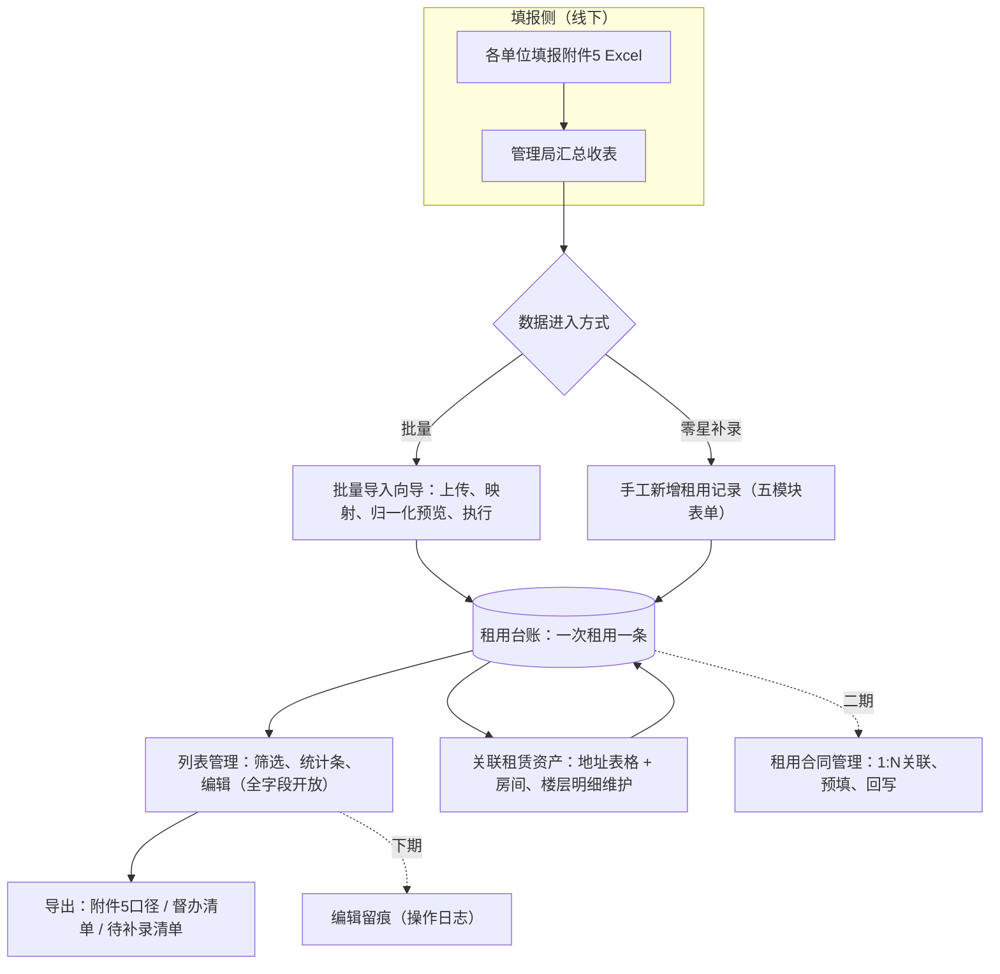
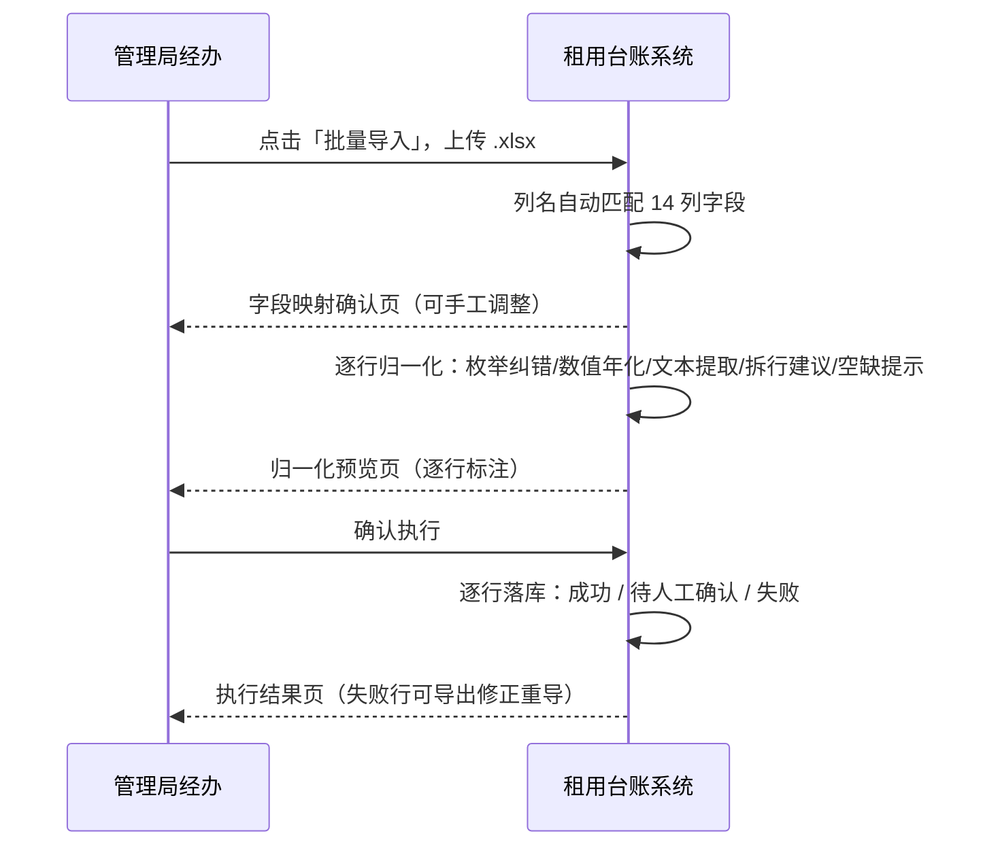
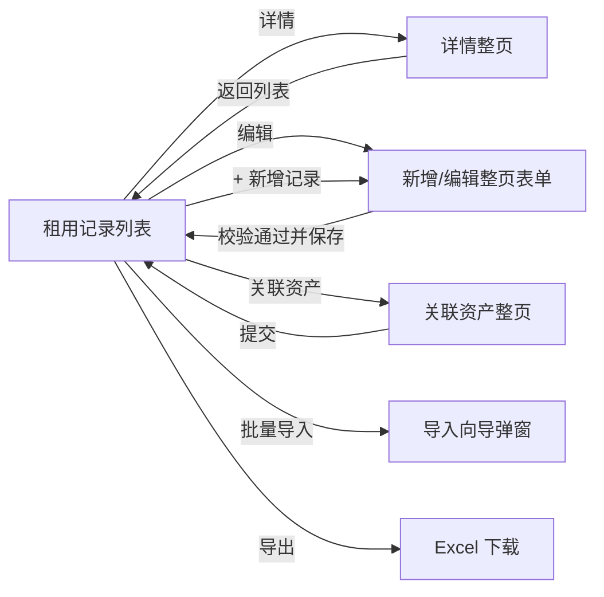
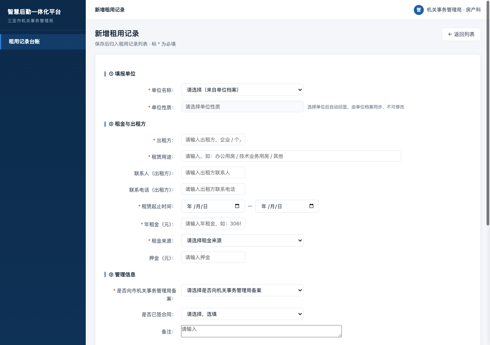
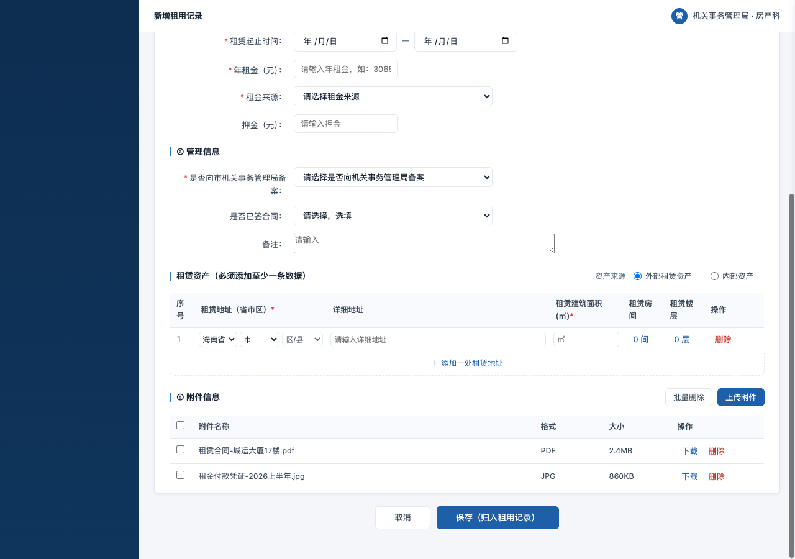
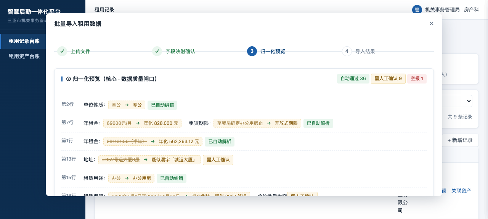

# 三亚市直单位办公用房租用台账 产品需求文档 V2.0

| 项目     | 内容                                   |
|----------|----------------------------------------|
| 文档名称 | 三亚市直单位办公用房租用台账 产品需求文档 V2.0 |
| 产品负责人 | 产品经理                               |
| 创建日期 | 2026-09-08                             |
| 最后更新 | 2026-09-08                             |
| 文档状态 | 草稿                                   |
| 当前版本 | V2.0                                   |
| 评审人   | 三亚市机关事务管理局（业务确认方）       |

> **范围声明**：本 PRD 覆盖「租用记录管理」模块（租用记录台账、数据导入/导出、租用记录新增/编辑、详情、关联租赁资产）。本模块是在系统现有功能【租用合同管理】基础上进行的迭代，菜单位置：**办公用房 → 业务办理 → 租赁管理 → 租用管理**，菜单命名为**【租用记录管理】**。合同衔接相关能力为二期规划（见 1.5 节迭代路标），本期不涉及。原型中的「租用资产台账」只读汇总视图仅作演示参考，不在本 PRD 范围内。
>
> **版本关系**：V2.0 为独立新版本文档，不替代、不覆盖 V1.1；V1.1 → V2.0 的全部变更见 2.1 变更说明。

---

# 第一部分：需求分析

## 1.1 背景与目标

### 需求背景

三亚市机关事务管理局对市直单位办公用房及技术业务用房的租赁情况开展摸底，使用线下 Excel 统计表（附件5《租用信息汇总表》）由各单位填报、管理局汇总。真实填报数据 46 条 / 40 余家单位，存在明显治理难题：

- 面积、租金约 1/3 为自由文本（按月计价、半年价、分项文字描述），无法直接求和；
- 枚举发散：单位性质、租赁用途存在错字、缩写、多种写法；
- 地址普遍写到楼层，部分到房号、商铺号；同一单位可多处租赁；
- 12 条未向市机关事务管理局备案、3 条备案信息空缺，督办依赖人工筛查；
- 全部租赁房源为**外部房产**，现有办公用房系统按「自有房产」标准建档（产权证号、建设年代等必填），外部租赁房源**录不进去**，业务系统创建合同时强制关联办公用房台账，形成阻塞。

客户核心诉求：**让附件5 这张表「进得去、出得来」**——把各单位报来的租用信息一次性导入系统形成台账，能按原口径导出还原，不愿逐条手工建档。

### 迭代基础

本次不是从零新建模块，而是在系统现有功能**【租用合同管理】**的基础上迭代：复用其所在的功能域与菜单体系，新增**【租用记录管理】**菜单（位置：办公用房 → 业务办理 → 租赁管理 → 租用管理），以「租用记录」为核心实体构建台账能力。现有【租用合同管理】的业务流程本期不做改动，合同与台账的衔接留待二期。

### 需求真伪判断

判定为真需求，依据有三：

1. **数据已存在且量大**：46 条真实填报是既有工作成果，导入是承接而非新增负担；
2. **现有系统结构性不兼容**：外部租赁房产无法按自有资产标准建档，属模型缺陷而非操作问题，客户无法自行绕过；
3. **监管动作有明确落点**：备案字段（是/否）在附件5 中真实填报，备案督办是管理局的现有职责，导入台账后筛选拿清单即可用。

### 需求目标

| 维度 | 目标 |
|------|------|
| 业务目标 | 附件5 租用底数全部落入系统，形成「一次租用一条记录」的租用台账，进得去、出得来 |
| 运营目标 | 备案督办的未备案/待补录清单由筛选+导出直接产出，取消人工翻表 |
| 产品目标 | 导入含脏数据归一化兜底（枚举纠错、数值年化、文本保留）；录入侧以「租赁地址（省市区）+ 租赁建筑面积」双必填保障台账可统计性 |

### 产品迭代节奏（分步走）

| 版本 | 核心目标 | 关键功能 | 计划周期 |
|------|----------|----------|----------|
| 一期（本期） | 把附件5 落到系统里 | 租用记录台账（列表+统计+筛选）、批量导入（含归一化）、导出、新增/编辑（五模块表单）、详情、关联租赁资产 | 本次交付 |
| 下期 | 编辑留痕 | 关键字段修改操作日志（谁/何时/改前→改后） | 随后迭代 |
| 二期（登记不做） | 合同衔接 | 租用记录↔合同 1:N 关联、带参跳转预填、合同回写台账 | 触发条件：客户补齐租赁标的信息 |

**跨期口径约定**：一期末投用的台账数据与二期合同数据并存后，**对外出数一律以租用台账为准**，合同仅作明细佐证，避免两套数据重复计数。

**编辑策略（2026-09-08 已拍板）**：本期**不做任何「不允许编辑」的场景**——台账唯一操作方为管理局，全部字段开放编辑，不做二次确认、不做修改留痕；**操作留痕列入下期**。理由：数据质量差是导入输入端问题，编辑是修复手段；禁编会逼使操作退回线下 Excel，台账失真。

### 本次迭代范围

**做什么**：租用记录台账（唯一列表视图，序号/单位名称冻结列）、批量导入（4 步向导含归一化预览）、导出（当前筛选结果智能命名）、新增/编辑租用记录（五模块整页表单，租赁地址+面积双必填逐行校验）、详情（整页页签，④租赁资产只读表格）、关联租赁资产（整页，复用表单共享模块，房间/楼层明细维护）。

**不做什么（一期边界）**：

1. 合同签订 / 审批 / 履约 / 应收推演等一切合同业务流程；
2. 台账 → 合同的跳转、预填、回写（含合同份数、合同金额合计等系统字段）；
3. 到期提醒、续租管理、租金执行监管；
4. 租用数据与办公用房资产树（楼栋/楼层/房间）的结构化关联与空间归类；
5. 单位在线填报（统一由管理局导入）；
6. 按单位存储的大宽表（附件5 一行=一处租用=一条记录，粒度 1:1，无需聚合层）；
7. 汇总表盖章落款样式还原（导出数据一致即可）；
8. 编辑操作留痕 / 修改日志 / 任何「禁止编辑」场景（下期）。

## 1.2 用户场景梳理

### 目标用户角色

| 角色名称 | 角色描述 | 使用频率 | 核心诉求 |
|----------|----------|----------|----------|
| 管理局经办人员 | 负责租用信息的导入、维护、纠错、出表 | 高频（集中报送期高频） | 导入省事、脏数据好改、导出即用 |
| 管理局负责人 | 查看租赁底数统计、督办备案情况 | 低频 | 统计可信、未备案清单一键拿到 |
| （二期）填报单位联系人 | 补录租赁标的信息、配合补录合同 | 低频 | 不重复填报（本期无在线填报，不涉及） |

### 核心场景

**场景 1：批量导入附件5（主场景）**

- **角色**：管理局经办
- **目标**：把各单位报来的附件5 Excel 一次性导入系统
- **前置条件**：已下载导入模板或持有附件5 原表（.xlsx）
- **典型路径**：列表页头「批量导入」→ 上传文件 → 确认字段映射（14 列自动匹配）→ 逐行查看归一化预览（枚举纠错、数值年化、拆行建议、空缺提示）→ 执行导入 → 查看成功/待人工确认/失败结果
- **异常路径**：列名匹配不上（手工调整映射）；行数据无法解析（进入「待人工确认」，不阻塞其余行）；失败行导出修正后重导
- **结果**：每行落成一条租用记录，台账统计即时生效

**场景 2：手工新增租用记录**

- **角色**：管理局经办
- **目标**：补录零星租用信息
- **典型路径**：「+ 新增记录」→ ①选择单位（性质自动回显）→ ②填写租金与出租方 → ③填写管理信息 → ④至少填一行租赁资产（省市区三级 + 面积必填，支持多处地址加行）→ ⑤（可选）上传附件 → 保存（归入租用记录）
- **异常路径**：单位未选 / 资产行省市区不完整或面积未填 → toast 提示「第 N 行：…」并阻断保存
- **结果**：列表新增一行；记录的租赁地址取第一处资产组合地址，租赁建筑面积取各行面积合计

**场景 3：编辑租用记录（纠错主路径）**

- **角色**：管理局经办
- **目标**：修正导入数据（错字、年化值、面积、备案状态等）
- **前置条件**：无（本期全字段开放编辑，无禁编场景）
- **典型路径**：列表操作列「编辑」→ 整页表单回显全字段（含按数据特征推导的「是否已签合同」、由导入原文解析出的租期日期）→ 修改 → 「保存修改」
- **异常路径**：同新增校验
- **结果**：列表、统计条即时刷新
- **边界**：本期不记录修改日志（下期实现）

**场景 4：关联租赁资产及房间/楼层明细维护**

- **角色**：管理局经办
- **目标**：为某条租用记录登记其租赁的房间/楼层明细
- **典型路径**：列表操作列「关联资产」→ 进入关联资产整页（即表单④模块）→ 逐行维护租赁地址（省市区+详细地址+面积）→ 点「租赁房间 N 间 / 租赁楼层 N 层」进入明细抽屉维护 → 提交（记录提交人与时间）
- **异常路径**：取消/返回列表 → 还原到打开时快照，未提交修改不生效；明细抽屉内取消同样还原
- **结果**：列表「是否关联资产」列更新（已关联/未关联）

**场景 5：备案督办出表**

- **角色**：管理局经办/负责人
- **目标**：产出未备案督办清单、备案待补录清单
- **典型路径**：筛选「是否备案=否」→ 页头「导出」→ 系统自动命名「未备案督办清单」；同理「未填写」→「备案待补录清单」
- **结果**：附件5 口径的 Excel 清单，可直接下发

**场景 6：按单位看合计**

- **角色**：管理局经办
- **目标**：查看某单位的租赁合计（处数、面积、租金）
- **典型路径**：关键字输入单位名 → 统计条四格即时重算为该单位口径（标注「当前筛选」）
- **结果**：无需独立汇总视图即可回答「这个单位租了多少」

## 1.3 业务流程图

### 整体业务流程



### 导入泳道图



## 1.4 信息架构图

### 页面结构（本期范围）

菜单入口：**办公用房 → 业务办理 → 租赁管理 → 租用管理 →【租用记录管理】**（在现有【租用合同管理】基础上迭代新增）。

```
├── 租用记录管理（菜单，位于 租用管理 之下）
│   └── 租用记录（唯一列表视图，打开菜单即达）
│       ├── 统计条（4 格，随筛选动态）
│       ├── 筛选区（5 项：关键字/单位性质/是否备案/是否已签合同/是否关联资产）
│       ├── 记录列表（16 列；序号+单位名称冻结列；操作列右侧固定）
│       ├── 页头操作（批量导入 / 导出 / +新增记录）
│       ├── 新增租用记录（整页表单，五模块）
│       │   ├── ① 填报单位
│       │   ├── ② 租金与出租方
│       │   ├── ③ 管理信息
│       │   ├── ④ 租赁资产（共享模块，表格版）
│       │   │   ├── 租赁房间明细（右侧抽屉维护）
│       │   │   └── 租赁楼层明细（右侧抽屉维护）
│       │   └── ⑤ 附件信息
│       ├── 编辑租用记录（复用同一整页表单，回显全字段）
│       ├── 记录详情（整页：基础信息〔五分组只读〕/ 账单信息〔二期占位〕）
│       │   └── 租赁房间/楼层（只读查看抽屉）
│       ├── 关联资产（整页，复用「④ 租赁资产」共享模块）
│       └── 数据导入（弹窗四步向导）
```

## 1.5 需求清单

| 优先级 | 需求编号 | 需求名称 | 所属模块 | 主要功能说明 | 关联角色 |
|--------|----------|----------|----------|--------------|----------|
| P0 | REQ-001 | 租用记录列表 | 租用台账 | 16 列附件5 口径列表；序号+单位名称冻结列；操作列（详情/编辑/关联资产）固定右侧 | 经办 |
| P0 | REQ-002 | 动态统计条 | 租用台账 | 备案单位/租用单位/面积合计/租金合计四格，随筛选实时重算并标注未计入条数 | 经办、负责人 |
| P0 | REQ-003 | 批量导入 | 租用台账 | 四步向导：上传→字段映射→归一化预览→执行结果 | 经办 |
| P0 | REQ-004 | 导出 | 租用台账 | 按当前筛选导出附件5 口径 Excel，清单名称随筛选智能命名 | 经办、负责人 |
| P1 | REQ-005 | 新增/编辑租用记录 | 租用台账 | 五模块整页表单；租赁地址（省市区）+租赁建筑面积逐行必填校验；面积由资产行合计自动推导；编辑回显全字段 | 经办 |
| P1 | REQ-006 | 记录详情 | 租用台账 | 整页页签：基础信息（五分组只读，④与表单同布局）/ 账单信息（二期占位） | 经办 |
| P1 | REQ-007 | 关联租赁资产 | 租用台账 | 独立整页，复用表单④共享模块；资产来源二选一（外部默认/内部）；房间/楼层明细抽屉；提交记录提交人/时间 | 经办 |
| P1 | REQ-008 | 筛选 | 租用台账 | 5 项筛选，支撑按单位合计、备案督办、待补录清单、签约状态查询等场景 | 经办 |
| P2 | REQ-009 | 下载模板 | 租用台账 | 导入模板下载，字段=附件5 完整字段集（入口：导入向导步骤①） | 经办 |
| P3 | REQ-010 | 编辑留痕 | 下期 | 关键字段修改操作日志（谁/何时/改前→改后）；本期全字段开放编辑且不留痕（已拍板） | 下期 |
| P3 | REQ-011 | 合同衔接 | 二期 | 记录↔合同 1:N 关联、带参跳转预填、合同回写（本期仅账单页签占位） | 二期 |

**需求影响点说明**：本次为现有【租用合同管理】功能的迭代，新增「租用记录管理」菜单与租用记录数据模型，不改动现有合同业务流程；二期衔接需前置验证两点（本期不调研）：①现有合同创建是否仍强制关联标的；②合同模块能否接收外部参数预填。

## 1.6 非功能性需求

| 维度 | 要求 |
|------|------|
| 性能 | 列表支持千条级数据分页流畅浏览；导入单次支持 ≥500 行，归一化预览响应 ≤5 秒 |
| 安全 | 关联资产提交记录提交人/时间；删除类操作需确认；编辑留痕见 REQ-010（下期） |
| 兼容性 | 主流 Chrome/Edge 浏览器；列表横向滚动时**序号、单位名称两列冻结**、操作列固定可见 |
| 数据容错 | 归一化三档兜底：结构化优先 → 半结构化解析（正则提取数值/日期）→ 文本兜底保留原值并打标记；不做强制校验阻塞录入 |

## 1.7 数据指标设计

| 指标类型 | 指标名称 | 定义 | 目标值 | 数据来源 |
|----------|----------|------|--------|----------|
| 北极星指标 | 附件5 落库率 | 已导入系统的记录数 / 附件5 总行数 | 100%（46/46） | 台账 |
| 辅助指标 | 归一化一次通过率 | 导入时无需人工确认即成功的行占比 | ≥80% | 导入日志 |
| 辅助指标 | 备案覆盖率 | 备案=是 的单位数 / 租用单位总数 | 持续提升 | 统计条 |
| 辅助指标 | 标的关联率 | 已关联租赁资产的记录数 / 总记录数 | 二期前提升 | 台账 |

---

# 第二部分：原型说明

## 2.1 变更说明

| 变更日期 | 变更版本 | 变更背景 | 变更功能 | 变更位置 | 变更内容详情 | 变更人 |
|----------|----------|----------|----------|----------|--------------|--------|
| 2026-09-07 | V0.9 | 三轮需求收敛 | 全部 | 全文 | 基于《原型v3功能清单（已确认稿）》起草 | 产品 |
| 2026-09-08 | V1.0 | 原型 v4.44 验收迭代 | 详情/关联资产/表单 | 第二部分 | ①详情由抽屉改整页页签；②关联资产由抽屉改整页并复用「关联租赁标的」共享模块；③租赁地址改省市区三级联动；④租赁用途改文本输入；⑤面积/是否已签合同改非必填 | 产品 |
| 2026-09-08 | V1.1 | 菜单口径确认 + 界面截图补充 | 全文 | 1.1 / 1.4 / 2.2 / 2.3 | ①明确基于现有【租用合同管理】迭代：菜单 办公用房→业务办理→租赁管理→租用管理，命名【租用记录管理】；②补充原型界面截图 | 产品 |
| 2026-09-08 | **V2.0** | 原型 v4.45–v4.57 迭代验收 + 编辑策略拍板 | 全部 | 全文 | 详见下方 V2.0 变更明细 | 产品 |

**V2.0 变更明细**（相对 V1.1，全部为已验收的原型实测状态）：

| # | 变更项 | V1.1 状态 | V2.0 状态 |
|---|--------|-----------|-----------|
| 1 | 筛选项 | 6 项（含租赁用途、合同状态） | **5 项**：删除「租赁用途」；「合同状态」改为「**是否已签合同**」（全部/已签/未签/长期/其他） |
| 2 | 列表「是否关联资产」列 | 显示房间/楼层计数 | 简化为**已关联 / 未关联** 两态 |
| 3 | 列表冻结列 | 仅操作列固定 | **序号 + 单位名称前两列冻结**（sticky），横向滚动不动 |
| 4 | 表单结构 | 区块一基础信息（含地址/面积字段）+ 关联租赁标的 | 重构为**五模块**：①填报单位 ②租金与出租方 ③管理信息 ④租赁资产 ⑤附件信息；联系人/联系电话归属**出租方** |
| 5 | 租赁资产录入方式 | 外部资产库选择抽屉 + 内联新建 | 改为**表格直填**：一行=一处租赁地址，列=序号/租赁地址（省市区）/详细地址/租赁建筑面积(㎡)/租赁房间/租赁楼层/删除；「＋添加一处租赁地址」加行；支持多处地址；默认一行；不做查重 |
| 6 | 省市区联动 | 全国 31 省全量 | 仅保留**海南省**，新行默认选中海南省 |
| 7 | 必填规则 | 面积非必填 | **租赁地址（省市区，逐行完整三级）+ 租赁建筑面积（逐行）必填**，保存/提交时按「第 N 行」报错 |
| 8 | 面积字段 | 表单含 合计/办公/业务 三行 | **删除**；保存时由④资产行面积**自动合计**推导，列表地址/面积随资产表联动 |
| 9 | 楼层新增弹窗 | 楼层类型下拉（地上/地下×单层/区间）+区间自动展开 | 改为**多行批量添加**：所在楼层（数字）/租赁楼层建筑面积/使用单位，逐行删除 |
| 10 | 详情页④ | 旧四行字段 + 资产表 | 与表单④**同布局只读表格**（序号/省市区/租赁地址/租赁建筑面积/租赁房间/租赁楼层），行面积自动合计；房间/楼层点击进**只读**查看抽屉 |
| 11 | 编辑策略 | Q3 待确认 | **已拍板**：本期全字段开放编辑、无禁编场景、不留痕；留痕下期（REQ-010） |
| 12 | 页头按钮 | 下载模板/批量导入/导出/+新增记录 | **批量导入/导出/+新增记录**；模板下载入口并入导入向导步骤① |

## 2.2 公共部分说明

### 菜单与导航

- 本模块在现有【租用合同管理】基础上迭代，菜单位置：**办公用房 → 业务办理 → 租赁管理 → 租用管理 →【租用记录管理】**；
- 「租用记录管理」**无二级菜单、无页签**，打开即租用记录列表；
- 面包屑随页面切换：租用记录 / 新增租用记录 / 编辑租用记录 / 记录详情 / 关联资产；
- 新增、编辑、详情、关联资产均为**整页**（非弹窗、非抽屉），页头右上「← 返回列表」。

### 全局交互规范

| 规则 | 说明 |
|------|------|
| 统计联动 | 任一筛选生效，统计条四格即时重算并标注「当前筛选」；面积/租金的非数值文本行不计入，在格内标注「N 条未计入」 |
| 空报行 | 关键字段整行空缺的记录（如空报行）默认隐藏，不出现在列表 |
| 必填标识 | 红星 `*` 前缀；保存时校验，toast 提示首个未通过项（资产行按「第 N 行」提示） |
| 编辑开放 | **全字段开放编辑，无禁编场景，本期不留痕**（2026-09-08 拍板，留痕见 REQ-010 下期） |
| 快照还原 | 关联资产整页打开时生成数据快照，「取消 / 返回列表」还原；房间/楼层明细抽屉「取消」同样还原至打开时状态 |
| 操作留痕（局部） | 关联资产「提交」记录提交人（当前登录人）+ 提交时间，展示于页面底部「最近提交：××× · 时间」及详情④区块 |
| 抽屉层级 | 明细维护类抽屉（房间/楼层）为右侧滑出，叠加于当前页面之上；详情页只读查看抽屉同层 |
| 列表冻结 | 横向滚动时序号、单位名称两列固定；第二列冻结偏移按第一列实际宽度动态计算；冻结列带右投影边界提示 |

### 全局状态定义

| 状态 | 定义 |
|------|------|
| 数据状态：正常 / 待补全 | 系统字段；待补全记录在统计条计数，不出独立列 |
| 是否备案：是 / 否 / 未填写 | 三态筛选与导出口径 |
| 是否已签合同：已签 / 未签 / 长期 / 其他 | 表单选填字段；导入记录由租赁期限特征推导预填（含「长期」→长期；「至…止」开放式→其他；其余→已签） |
| 是否关联资产：已关联 / 未关联 | 列表标签，仅两态，不展示明细计数 |
| 合同状态（二期口子） | 本期不展示；详情「账单信息」页签为二期占位 |

### 受控字典（数据字典）

| 字典 | 枚举值 |
|------|--------|
| 单位性质 | 行政 / 参公 / 公益一类（来自单位档案，导入时纠错归一：叁公→参公、公益一→公益一类） |
| 租金来源 | 财政拨款 / 自有资金 / 其他 |
| 是否向市机关事务管理局备案 | 是 / 否 |
| 是否已签合同 | 已签 / 未签 / 长期 / 其他 |
| 租赁用途 | 文本录入（不设枚举强制），导入时容错归一：办公→办公用房、自由文本→其他用途 |
| 房间用途 | 办公 / 业务 / 其他 |

### 权限

本期仅管理局侧使用（经办可增改导，负责人可查看）；角色权限沿用系统既有体系，不新增权限模型。管理员可直接修改/删除单位报来的记录，**本期不留操作日志**（编辑留痕下期，REQ-010）。

## 2.3 功能模块说明

### 2.3.0 模块总流程



### 2.3.1 租用记录列表（REQ-001/002/008）

**页面结构**：页头（标题 + 操作按钮）→ 统计条（4 格）→ 筛选区（5 项）→ 工具行（批量导入/导出/+新增记录）→ 数据表格。


**页头操作按钮**

| 按钮 | 行为 |
|------|------|
| 批量导入 | 打开导入向导弹窗（见 2.3.5） |
| 导出 | 按当前筛选结果导出附件5 口径 Excel（数据一致即可，不还原盖章样式） |
| + 新增记录 | 进入「新增租用记录」整页表单 |

**统计条（4 格，随筛选动态重算）**

| 格 | 口径 |
|----|------|
| 备案单位（全部/当前筛选） | 是否备案=是 的记录数（按去重单位） |
| 租用单位（家） | 当前筛选结果去重单位数 |
| 租赁建筑面积合计（㎡） | 数值行求和；非数值文本行不计入并标注「N 条未计入」 |
| 年租金合计（万元） | 结构化年租金求和；文本行不计入并标注 |

**筛选条件（5 项）**

| 筛选项 | 类型 | 选项 |
|--------|------|------|
| 关键字 | 文本输入 | 匹配 单位 / 地址 / 出租方 |
| 单位性质 | 下拉 | 全部 / 行政 / 参公 / 公益一类 / 未填写 |
| 是否向市机关事务管理局备案 | 下拉 | 全部 / 是 / 否 / 未填写 |
| 是否已签合同 | 下拉 | 全部 / 已签 / 未签 / 长期 / 其他 |
| 是否关联资产 | 下拉 | 全部 / 是 / 否 |

**列表字段（16 列，附件5 完整口径；序号、单位名称两列冻结）**

| # | 列名 | 说明 |
|---|------|------|
| 1 | 序号 | 冻结列 |
| 2 | 单位名称 | 冻结列；支持同单位多行（多处租赁分行） |
| 3 | 单位性质 | 行政 / 参公 / 公益一类 / 未填 |
| 4 | 租赁地址 | 原文展示（可到楼层/房号）；编辑保存后取第一处资产组合地址 |
| 5 | 租赁建筑面积(办公/业务㎡) | 结构化合计 + 原文分项附注（subnote）；编辑保存后取资产行面积合计 |
| 6 | 出租方 | 仅名称（类型标签不在列表展示） |
| 7 | 租赁用途 | 原文 |
| 8 | 租赁期限 | 原文（含长期、开放式租期） |
| 9 | 年租金(元) | 结构化数值；非数值原文附注「原文：×××」 |
| 10 | 租金来源 | 财政拨款 / 自有资金 / 其他 |
| 11 | 是否向市机关事务管理局备案 | 是 / 否 / 未填（标签色区分） |
| 12 | 联系人 | 出租方联系人 |
| 13 | 联系电话 | 出租方联系电话 |
| 14 | 备注 | — |
| 15 | 是否关联资产 | 已关联 / 未关联（标签色区分） |
| 16 | 操作 | 详情 / 编辑 / 关联资产；**列固定右侧**，横向滚动时可见 |

**行交互**：点击整行进入详情；操作列三个按钮阻止行冒泡。

**空状态**：无数据或筛选无结果时展示空态提示。

### 2.3.2 新增 / 编辑租用记录（REQ-005）

**页面形态**：整页表单，**五模块**区块式单页滚动；页头标题区分「新增租用记录 / 编辑租用记录」；底部居中「取消 / 保存」双按钮，保存按钮文案随态切换（新增：保存（归入租用记录）；编辑：保存修改）。编辑态复用同一页面，回显全字段（含由导入原文解析出的租期日期、按数据特征推导的「是否已签合同」；单位不在档案下拉时动态补选项）。



**模块① · 填报单位（字段清单表）**

| 字段名称 | 字段类型 | 是否必填 | 校验规则 | 默认值 | 备注说明 |
|----------|----------|----------|----------|--------|----------|
| 单位名称 | 下拉（单位档案） | 是 | 必选 | 空 | 选中后联动回显单位性质 |
| 单位性质 | 文本（只读） | — | 系统回显 | 空 | 由单位档案同步，不可修改 |

**模块② · 租金与出租方**

| 字段名称 | 字段类型 | 是否必填 | 校验规则 | 默认值 | 备注说明 |
|----------|----------|----------|----------|--------|----------|
| 出租方 | 文本 | 是 | — | 空 | 含个人、民企等 |
| 租赁用途 | 文本输入 | 是 | — | 空 | 自由文本，如：办公用房 / 技术业务用房 / 其他 |
| 联系人（出租方） | 文本 | 否 | — | 空 | 出租方信息 |
| 联系电话（出租方） | 文本 | 否 | — | 空 | 出租方信息 |
| 租赁起止时间 | 日期区间 | 是 | 结束≥开始 | 空 | 开放式租期可只填一侧；导入记录由中文日期自动解析回显 |
| 年租金（元） | 文本 | 是 | 数字 | 空 | 如：306528 |
| 租金来源 | 下拉 | 是 | 必选 | 空 | 财政拨款 / 自有资金 / 其他 |
| 押金（元） | 文本 | 否 | 数字 | 空 | 附件5 无此列，导入不含，仅手工录入 |

**模块③ · 管理信息**

| 字段名称 | 字段类型 | 是否必填 | 校验规则 | 默认值 | 备注说明 |
|----------|----------|----------|----------|--------|----------|
| 是否向市机关事务管理局备案 | 下拉 | 是 | 必选 | 空 | 是 / 否 |
| 是否已签合同 | 下拉 | 否 | — | 空 | 已签 / 未签 / 长期 / 其他 |
| 备注 | 多行文本 | 否 | — | 空 | — |

**模块④ · 租赁资产（表格版，共享模块）**

模块标题：「租赁资产（必须添加至少一条数据）」；标题右侧「资产来源」单选：**外部租赁资产（默认） / 内部资产**。同一模块 DOM 在三处复用：新增表单、编辑表单、列表「关联资产」整页。



**外部分支（默认）**：已关联租赁资产表格，**一行 = 一处租赁地址**：

| 列名 | 类型 | 是否必填 | 说明 |
|------|------|----------|------|
| 序号 | 自增 | — | — |
| 租赁地址（省市区） | 三级下拉联动 | **是（三级均须选择）** | 国标 GB/T 2260 联动，**仅海南省**可选，新行默认选中海南省 |
| 详细地址 | 文本输入 | 否 | 占位「请输入详细地址」，如：××路××号××楼（部分） |
| 租赁建筑面积(㎡) | 文本 | **是** | 数字 |
| 租赁房间 | 链接 | — | 显示「N 间」，点击进入房间明细抽屉 |
| 租赁楼层 | 链接 | — | 显示「N 层」，点击进入楼层明细抽屉 |
| 操作 | 删除 | — | 即时删行（编辑态同步刷新列表标签） |

- 表格下方「＋ 添加一处租赁地址」加行，支持多处租赁地址，**不做查重**；
- **默认显示一行**（省=海南省）；
- **逐行校验**（保存/提交时）：省市区三级完整、面积非空，不通过 toast「第 N 行：请选择完整的省市区 / 请填写租赁建筑面积」并阻断；至少一行。

**内部分支**：已选内部资产表（序号/资产编号/资产名称/资产大类/资产类别/原资产使用单位/资产产权单位/区(县)/详细地址），右上「选择资产」接入现有办公用房资产台账选择器（原型占位）。切换为内部后外部表格收起。

**租赁房间明细抽屉**（点「N 间」进入，标题带资产名）：筛选（使用单位 / 所属楼层 / 房间用途）+ 房间勾选列表（房间号/房间名称/所属楼层/房间用途/使用单位）+「新增」房间弹窗（房间号*、房间名称、房间用途、使用单位、租赁房间建筑面积）+ 确定。取消还原快照。


**租赁楼层明细抽屉**（点「N 层」进入，标题带资产名）：所在楼层筛选 + 楼层勾选列表（所在楼层/使用单位/租赁楼层建筑面积）+「新增」楼层弹窗——**多行批量添加**（所在楼层(数字) / 租赁楼层建筑面积 / 使用单位，逐行删除，可批量加行）+ 确定。取消还原快照。

**模块⑤ · 附件信息**：上传附件、批量删除；附件表（勾选 / 名称 / 格式 / 大小 / 操作：下载、删除）。

**保存行为与联动规则**：

- 校验顺序：单位名称 → ④逐行校验（省市区/面积）→ 通过后保存；
- 记录的**租赁地址 = 第一处资产的省市区+详细地址组合**；
- 记录的**租赁建筑面积 = 各资产行面积自动合计**（表单不再单设面积字段）；
- 新增 → 归入租用记录列表；编辑 → 更新原记录；列表、统计条、「是否关联资产」标签即时刷新。

### 2.3.3 记录详情（REQ-006）

**页面形态**：整页，页头显示单位名 +「← 返回列表」；页签两个：

| 页签 | 内容 |
|------|------|
| 基础信息（默认） | 按**五分组**只读展示：①填报单位 ②租金与出租方（含出租方类型标签、年租金原文/解析值、押金及「附件5 未采集」说明）③管理信息 ④租赁资产 ⑤附件信息 |
| 账单信息 | 二期占位页（生命周期账单规划说明，本期不实现明细） |

**④ 租赁资产区块（与表单同布局，纯只读）**：表格列 = 序号 / 省市区 / 租赁地址 / 租赁建筑面积(㎡) / 租赁房间 / 租赁楼层，**无操作列**；未关联记录显示「未关联」兜底提示；行面积自动合计显示「合计租赁建筑面积：N ㎡（由资产行面积自动合计）」；展示「最近提交：提交人 · 时间」。**租赁房间 / 租赁楼层点击后为只读查看抽屉**（仅列表展示，无筛选、无勾选、无确认按钮）。


### 2.3.4 关联资产整页（REQ-007）

**入口**：列表操作列「关联资产」→ 进入独立整页（页面承载能力优于抽屉方案）。

**行为规则**：

- 页面内容即 2.3.2 模块④的共享模块（资产来源单选 + 租赁地址表格 + 房间/楼层明细抽屉），字段与新增表单完全一致；
- 打开时生成该记录关联数据快照；**提交**走逐行必填校验，通过后保存并记录提交人/时间（页面底部「最近提交：××× · 时间」）；**取消 / 返回列表**还原快照，未提交修改不生效；
- 页面标题：「关联资产 · {单位名称}」。

### 2.3.5 数据导入（REQ-003，弹窗四步向导）

| 步骤 | 功能 | 说明 |
|------|------|------|
| ① 上传 | .xlsx 上传、模板下载 | 模板字段 = 附件5 完整字段集（含备注、面积分项）；下载模板入口在本步 |
| ② 字段映射 | 列名自动匹配确认 | 14 列映射表，匹配不上的可手工调整 |


| ③ 归一化预览（核心） | 逐行标注解析结果 | 枚举纠错（叁公→参公、公益一→公益一类、办公→办公用房）；数值解析（69000元/月→年化 82.8 万、281131.56（半年）→年化）；文本面积提取；一格多值拆行建议；空缺与矛盾提示（起止倒挂、整行空报） |
| ④ 执行结果 | 成功 / 待人工确认 / 失败 | 三态分行；失败行可导出修正后重导 |



**数据模型承接**：租用记录 = 14 个业务字段（与附件5 对齐）+ 系统字段（租用来源：批量导入/手工新增；数据状态：正常/待补全；归一化标记）+ 承接字段（出租方类型自动识别打标：国企平台/民企/个人/运营商；结构化租期起止；结构化年租金，**文本兜底保留原值**）。归一化结果是否「原文+归一值」双轨保留见待确认 Q1。

### 2.3.6 导出与备案监督（REQ-004）

不设独立备案监督视图，由「备案筛选 + 导出」承接；导出清单名称随当前筛选智能命名：

| 场景 | 操作 | 导出命名 |
|------|------|----------|
| 未备案督办清单 | 筛「是否备案=否」→ 导出 | 未备案督办清单（真实数据 12 条） |
| 备案待补录清单 | 筛「未填写」→ 导出 | 备案待补录清单（3 条） |
| 签约状态清单 | 筛「是否已签合同」→ 导出 | 已签合同清单 / 未签合同清单 / 长期租用清单 / 其他签约状态清单 |
| 完整底数 | 不筛选 → 导出 | 租用记录（附件5 口径） |

### 2.3.7 交互状态说明

| 状态 | 处理方式 |
|------|----------|
| 加载中 | 列表/导入预览展示加载态 |
| 空状态 | 列表无数据/无筛选结果：空态提示 +「+ 新增记录」「批量导入」引导；关联资产表格默认补一行空白行 |
| 错误状态 | 导入失败行独立列出可导出重导；表单校验失败 toast 提示首个错误（资产行按「第 N 行」） |
| 并发编辑 | 关联资产采用打开时快照+提交覆盖，后提交者以最新数据为准（原型阶段不做锁） |

---

# 第三部分：附录

## 3.1 术语表

| 术语/缩写 | 全称 | 定义说明 |
|-----------|------|----------|
| 附件5 | 租用信息汇总表 | 各单位线下填报、管理局汇总的 Excel 总表（46 条真实数据），本模块的数据源头与导出口径 |
| 附件3 | 办公用房及技术业务用房租用信息统计表 | 空白填报模板（13 列），附件5 的模板版 |
| 租用记录 | — | 系统第一公民实体：一次租用一条记录，与附件5 行 1:1 对应 |
| 租赁资产（行） | — | 表单④表格中的一行 = 一处租赁地址（省市区+详细地址+面积），可挂房间/楼层明细 |
| 归一化 | — | 将自由文本解析为结构化值并纠错的过程；无法解析时文本兜底保留原值 |
| 待补全 | — | 关键字段空缺或矛盾的记录状态 |
| 外部租赁资产 | — | 非自有、由单位租入的房产（地址级），区别于资产树中的自建资产 |
| 冻结列 | — | 列表横向滚动时位置固定的列（本期：序号、单位名称） |

## 3.2 风险与依赖

| 风险/依赖 | 类型 | 影响范围 | 应对方案 | 负责人 |
|-----------|------|----------|----------|--------|
| 数据质量：约 1/3 面积租金为自由文本，自动归一化覆盖有限 | 风险 | 导入、统计 | 归一化预览作为质量闸口不可省；文本兜底保留原值；人工修正 | 产品/研发 |
| 单位主数据缺失：同一单位名称写法不一、性质不一 | 风险 | 单位聚合统计、单位下拉 | 建议后续接入单位字典做主数据；本期按名称去重 | 产品 |
| 编辑无留痕：本期开放编辑且不留日志，误改无法追溯 | 风险 | 数据审计 | 已拍板接受（2026-09-08）；留痕列入下期（REQ-010），上线初期建议按导入批次备份数据 | 产品 |
| 导入模板与真实填报字段差异（备注列、面积分项） | 依赖 | 导入映射 | 模板与映射均按「客户实际填报完整字段集」设计 | 产品 |
| 二期合同模块强制关联标的 | 依赖 | 二期合同衔接 | 二期立项前先验证（本期不调研） | 产品 |

## 3.3 上线策略

- **数据初始化**：上线后首批执行附件5 全量导入（46 行），失败行人工修正补导，落库率目标 100%；
- **培训**：面向管理局经办提供导入操作指引（重点：归一化预览确认与失败行重导）与表单必填规则说明（租赁地址省市区+面积逐行必填）；
- **回滚**：新增模块独立，异常时可停用菜单入口，不影响既有系统；导入数据按批次留痕，可按批次清理重导。

## 3.4 待确认问题

| # | 问题 | 状态 / 建议 |
|---|------|------|
| Q1 | 归一化结果覆盖原值，还是「原文+归一值」双轨保留 | 待确认。建议双轨保留（审计可溯）；⚠️ 与编辑功能耦合：若不保留原文，记录被编辑后与附件5 断绝对账能力，须与编辑策略一并拍板 |
| Q2 | 汇总合计口径：文本兜底行是否计入 | 已确认：仅计数值行，标注未计入笔数（已按此实现） |
| Q3 | 管理局可否直接修改/删除单位报来的记录 | **已拍板（2026-09-08）**：可改，本期全字段开放编辑、不留痕；操作留痕下期实现（REQ-010） |
| Q4 | 二期合同与记录的数量口径（一址多房东场景） | 一条记录可挂 N 份合同（N 可为 0），二期确认 |
| Q5 | 二期「租赁标的怎么表达」（补挂资产树 vs 轻量标的档案） | 二期第一步先定此项，再启动合同衔接 |
